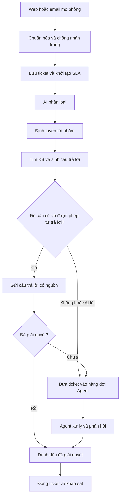
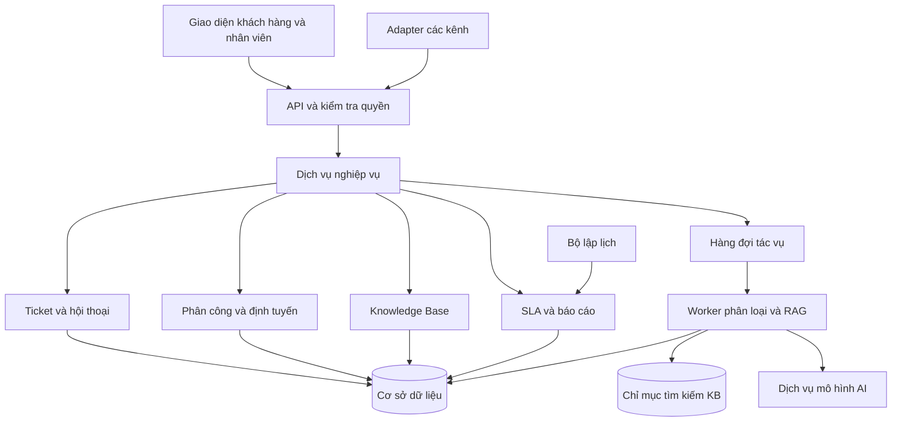
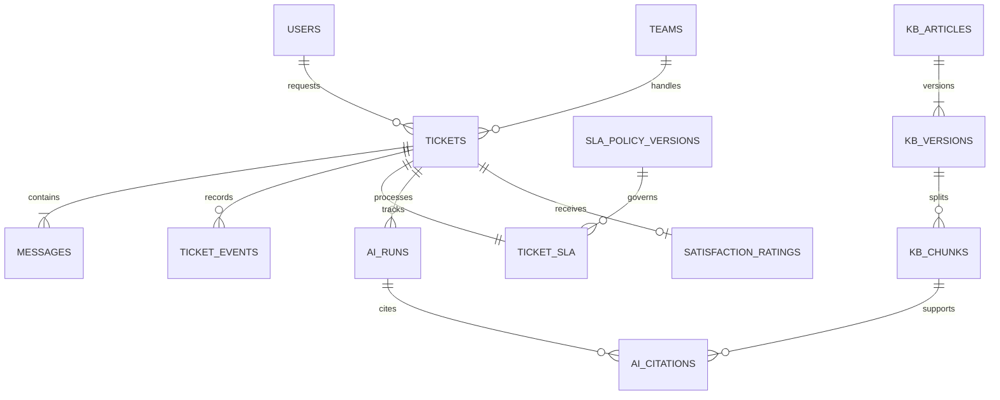

# Phân tích và thiết kế chủ đề 7: Nền tảng Helpdesk đa kênh

> Tài liệu thiết kế ban đầu cho nhóm 5 người, dựa trên đề tài học phần TK&XD PM, học kỳ 20261. Các quy tắc và số liệu được ghi là đề xuất cần được nhóm thống nhất trước khi triển khai.

## 1. Bài toán và mục tiêu

Khách hàng gửi yêu cầu hỗ trợ qua nhiều kênh như biểu mẫu web, email, live chat hoặc mạng xã hội. Khi các yêu cầu nằm rải rác, nhân viên có thể bỏ sót, trả lời trùng hoặc không xử lý đúng thời hạn. Hệ thống đưa các yêu cầu về một luồng ticket thống nhất, hỗ trợ phân loại và định tuyến bằng AI, tìm câu trả lời từ cơ sở tri thức (Knowledge Base - KB), theo dõi SLA và chuyển cho nhân viên khi AI không đủ căn cứ.

Mục tiêu MVP:

- Tiếp nhận yêu cầu từ biểu mẫu web và một kênh email mô phỏng.
- Tạo, phân loại, tìm kiếm, phân công và theo dõi ticket.
- Lưu hội thoại, phân biệt phản hồi khách hàng với ghi chú nội bộ.
- Quản lý KB và tìm bài viết phù hợp với câu hỏi.
- Tích hợp AI phân loại, định tuyến và trả lời dựa trên KB có dẫn nguồn.
- Theo dõi SLA, cảnh báo, chuyển cấp và thống kê hoạt động.
- Cho phép Agent tiếp quản khi AI lỗi, không chắc chắn hoặc không tìm thấy nguồn phù hợp.

Phân tích cảm xúc, tóm tắt hội thoại dài và tích hợp nhiều mạng xã hội thật là phần mở rộng. Có thể mô phỏng các kênh khi demo.

## 2. Tác nhân và quyền hạn

| Tác nhân | Quyền chính |
|---|---|
| Khách hàng | Gửi yêu cầu, xem ticket của mình, bổ sung thông tin, xác nhận giải quyết và đánh giá |
| Agent | Xem hàng đợi được cấp quyền, xử lý ticket được phân công, phản hồi khách hàng, ghi chú nội bộ và dùng gợi ý AI |
| Supervisor | Giám sát nhóm, phân công lại, điều chỉnh ưu tiên, xử lý chuyển cấp và xem báo cáo |
| Admin | Quản lý tài khoản, vai trò, nhóm, kênh, danh mục và chính sách SLA |

Quyền truy cập phải được kiểm tra trên từng ticket. Khách hàng chỉ được xem ticket của mình. Ghi chú nội bộ không được trả về API khách hàng hoặc đưa vào ngữ cảnh sinh câu trả lời công khai. Có thể yêu cầu Supervisor duyệt bài KB trước khi xuất bản.

## 3. Phạm vi yêu cầu chức năng

| Mã | Yêu cầu | Ưu tiên |
|---|---|---|
| FR01 | Đăng nhập, đăng xuất, phân quyền và quản lý tài khoản | Must |
| FR02 | Tiếp nhận yêu cầu từ các kênh theo một định dạng chung | Must |
| FR03 | Tạo ticket, lưu nguồn gửi và chống tạo trùng sự kiện | Must |
| FR04 | Tìm kiếm, lọc ticket theo trạng thái, danh mục, nhóm và Agent | Must |
| FR05 | AI phân loại ticket; nhân viên có thể sửa kết quả | Must |
| FR06 | Định tuyến tới nhóm và phân công Agent | Must |
| FR07 | Trao đổi với khách hàng và lưu lịch sử hội thoại | Must |
| FR08 | Ghi chú nội bộ, tách khỏi nội dung khách hàng nhìn thấy | Must |
| FR09 | Quản lý vòng đời ticket và lưu nhật ký thay đổi | Must |
| FR10 | Quản lý, xuất bản và tìm kiếm bài viết KB | Must |
| FR11 | Sinh câu trả lời RAG có dẫn nguồn và cơ chế chuyển người | Must |
| FR12 | Tính hạn SLA, cảnh báo và chuyển cấp | Must |
| FR13 | Khảo sát mức độ hài lòng sau khi giải quyết | Must |
| FR14 | Báo cáo thời gian phản hồi, tuân thủ SLA và mức hài lòng | Must |
| FR15 | Đính kèm tệp có kiểm tra loại và kích thước | Should |
| FR16 | Thông báo cập nhật gần thời gian thực | Should |
| FR17 | Tóm tắt hội thoại và phân tích cảm xúc | Could |
| FR18 | Tích hợp nhiều mạng xã hội thật | Chưa làm trong MVP |

## 4. Quy trình nghiệp vụ

### 4.1 Tiếp nhận và xử lý ticket

1. Khách gửi yêu cầu qua web hoặc email mô phỏng.
2. Adapter chuẩn hóa sự kiện và kiểm tra mã sự kiện để chống nhận trùng.
3. Hệ thống lưu ticket và khởi tạo đồng hồ SLA.
4. AI đề xuất danh mục; luật định tuyến chọn nhóm và Agent phù hợp.
5. Hệ thống tìm bài KB và có thể tạo câu trả lời kèm nguồn.
6. Nếu đủ căn cứ và thuộc phạm vi tự động, câu trả lời được gửi; nếu không, ticket vào hàng đợi Agent.
7. Agent xử lý, phản hồi và cập nhật trạng thái.
8. Khi giải quyết, khách xác nhận hoặc ticket được đóng theo quy tắc cấu hình; hệ thống gửi khảo sát hài lòng.



### 4.2 Trạng thái ticket đề xuất

| Trạng thái | Ý nghĩa |
|---|---|
| `NEW` | Đã tiếp nhận, chờ xử lý |
| `IN_PROGRESS` | Nhân viên đang xử lý |
| `WAITING_CUSTOMER` | Đang chờ khách hàng bổ sung thông tin |
| `RESOLVED` | Đã đưa ra phương án giải quyết |
| `CLOSED` | Ticket đã hoàn tất |

Chuyển trạng thái chính:

- `NEW → IN_PROGRESS`: Agent nhận xử lý.
- `IN_PROGRESS → WAITING_CUSTOMER`: cần khách hàng cung cấp thêm thông tin.
- `WAITING_CUSTOMER → IN_PROGRESS`: khách hàng trả lời.
- `IN_PROGRESS → RESOLVED`: Agent xác nhận đã giải quyết.
- `RESOLVED → IN_PROGRESS`: khách báo vấn đề vẫn còn.
- `RESOLVED → CLOSED`: khách xác nhận hoặc hết thời gian chờ theo cấu hình.

Ticket đóng rồi thì yêu cầu mới tạo ticket mới và có thể liên kết ticket cũ. Trạng thái ticket được quản lý riêng với trạng thái của tác vụ AI.

## 5. Use case trọng tâm và phạm vi tuần 1

Kế hoạch tuần 1 được chốt thành tám Use Case (UC01–UC08), chia theo đúng bốn nhóm chức năng của đề tài. Bảng Use Case chi tiết, Actor, lịch bảy ngày, đầu ra và tiêu chí nghiệm thu được quản lý trong [Kế hoạch tuần 1 — Phân tích và thiết kế Use Case](Ke-hoach-tuan-1-Use-Case-Chu-de-07.md). Bảng dưới đây là các luồng nghiệp vụ nền để nhóm phát triển đặc tả; dùng mã UC tuần 1 khi hợp nhất tài liệu.

| Use case tuần 1 | Luồng chính | Ngoại lệ cần xử lý |
|---|---|---|
| UC01 — Gửi và tiếp nhận yêu cầu hỗ trợ | Khách hoặc kênh gửi yêu cầu → kiểm tra hợp lệ → tiếp nhận và phản hồi mã yêu cầu | Thiếu nội dung; kênh gửi lại sự kiện; nguồn không xác thực |
| UC02 — Tạo và tổng hợp ticket | Hệ thống chuẩn hóa sự kiện → tạo/cập nhật ticket phù hợp → lưu hội thoại và nguồn | Sự kiện trùng; không ghép được khách; lỗi lưu |
| UC03 — Xử lý và cập nhật trạng thái ticket | Agent mở ticket → xem hội thoại → phản hồi/cập nhật trạng thái → lưu lịch sử | Mất quyền; xung đột cập nhật; gửi phản hồi thất bại |
| UC04 — AI phân loại và định tuyến ticket | Phân loại → kiểm tra kết quả → áp dụng quy tắc nhóm/Agent | AI lỗi/không chắc chắn; không có Agent thì giữ ở hàng đợi nhóm |
| UC05 — Theo dõi SLA, cảnh báo và chuyển cấp | Tính hạn → kiểm tra mốc → cảnh báo và chuyển cấp theo quy tắc | Tác vụ lặp không tạo cảnh báo trùng; ticket đổi trạng thái sát thời điểm kiểm tra |
| UC06 — Quản lý bài viết Knowledge Base | Soạn/sửa → gửi duyệt → xuất bản hoặc thu hồi bài | Thiếu nội dung; người dùng không có quyền duyệt; phiên bản cũ |
| UC07 — AI RAG gợi ý câu trả lời có dẫn nguồn | Tìm KB phù hợp → tạo gợi ý và nguồn → Agent xem, sửa, gửi hoặc chuyển cấp | Không có nguồn; nguồn mâu thuẫn/hết hiệu lực; AI lỗi hoặc khách yêu cầu người |
| UC08 — Xem báo cáo ticket, SLA và CSAT | Supervisor/Admin chọn kỳ và bộ lọc → xem chỉ số/tổng hợp | Không có dữ liệu; thiếu quyền; dữ liệu chưa đủ kỳ báo cáo |

## 6. Thiết kế SLA

Mức dưới đây là cấu hình minh họa để demo, không phải số liệu bắt buộc của đề bài.

| Ưu tiên | Thời hạn phản hồi đầu tiên | Thời hạn giải quyết |
|---|---:|---:|
| Khẩn cấp | 15 phút | 4 giờ |
| Cao | 1 giờ | 8 giờ |
| Bình thường | 4 giờ | 24 giờ |
| Thấp | 8 giờ | 48 giờ |

Quy tắc MVP đề xuất:

- Tính thời gian liên tục 24/7 để tránh phải xây lịch làm việc ngay từ đầu.
- Email xác nhận đã nhận yêu cầu không tính là phản hồi xử lý.
- Phản hồi hữu ích từ Agent hoặc AI được gửi thành công có thể tính là phản hồi đầu tiên; báo cáo phân biệt phản hồi của AI và người.
- `WAITING_CUSTOMER` vẫn tính thời gian trong MVP.
- Cảnh báo khi đã dùng 80% thời gian; quá hạn thì báo Supervisor.
- Lưu phiên bản chính sách SLA áp dụng cho mỗi ticket.
- Ticket mở lại tiếp tục dùng hạn giải quyết ban đầu trong MVP.

Nếu triển khai giờ hành chính hoặc tạm dừng SLA, cần bổ sung lịch làm việc và lịch sử khoảng tạm dừng.

## 7. Kiến trúc hệ thống

Đề xuất ứng dụng nguyên khối chia module, tổ chức theo lớp. Cách này phù hợp với phạm vi học phần và vẫn tách trách nhiệm rõ ràng.



Ticket phải được lưu trước khi gọi AI. Nếu AI không khả dụng, khách vẫn gửi yêu cầu được và Agent vẫn xử lý. Các module dự kiến: `identity`, `channels`, `tickets`, `routing`, `knowledge`, `ai`, `sla`, `notifications`, `reporting`.

## 8. Thiết kế cơ sở dữ liệu

| Bảng | Trường và vai trò chính |
|---|---|
| `users` | `id`, `name`, `email`, `password_hash`, `status` |
| `roles`, `user_roles` | Vai trò và quan hệ người dùng-vai trò |
| `teams`, `team_members` | Nhóm hỗ trợ và thành viên |
| `categories` | Danh mục ticket |
| `routing_rules` | Ánh xạ danh mục tới nhóm, độ ưu tiên luật |
| `channels` | Loại kênh, tên và cấu hình kết nối |
| `channel_identities` | Liên kết định danh ngoài kênh với khách hàng đã xác minh |
| `tickets` | `id`, `customer_id`, `channel_id`, `category_id`, `team_id`, `assignee_id`, `subject`, `status`, `priority`, `created_at`, `version` |
| `messages` | `id`, `ticket_id`, `sender_id`, `sender_type`, `visibility`, `body`, `delivery_status`, `created_at` |
| `channel_events` | Mã sự kiện ngoài, kênh và trạng thái tiếp nhận |
| `ticket_events` | Lịch sử đổi trạng thái, phân công, ưu tiên và người thực hiện |
| `sla_policy_versions` | Phiên bản chính sách và thời hạn theo ưu tiên |
| `ticket_sla` | Chính sách áp dụng, các hạn và thời điểm phản hồi/giải quyết |
| `sla_alerts` | Cảnh báo đã phát và loại cảnh báo |
| `kb_articles`, `kb_versions` | Bài viết, phiên bản nội dung, trạng thái xuất bản và phạm vi truy cập |
| `kb_chunks` | Đoạn nội dung được lập chỉ mục và phiên bản nguồn |
| `ai_runs` | Loại tác vụ, kết quả, phiên bản mô hình/prompt, thời gian chạy, lý do fallback |
| `ai_citations` | Liên kết kết quả AI với các đoạn KB được dùng |
| `satisfaction_ratings` | Ticket, người đánh giá, điểm và nhận xét |



Ràng buộc dữ liệu đề xuất:

- Unique `(channel_id, external_event_id)` để chống tiếp nhận trùng.
- Agent được gán phải là thành viên của nhóm xử lý.
- Ghi chú `INTERNAL` không được đưa vào API khách hàng hoặc nội dung tự trả lời.
- Cập nhật ticket dùng `version` để phát hiện sửa đồng thời.
- Vai trò, thành viên và nguồn trích dẫn dùng bảng quan hệ riêng, không lưu danh sách ID trong một chuỗi.

Đây là lược đồ logic ban đầu. D2 cần chốt kiểu dữ liệu, khóa, chỉ mục và kiểm tra chuẩn hóa chi tiết.

## 9. Thiết kế AI

### 9.1 Phân loại và định tuyến

Ví dụ đầu vào: “Tôi đã thanh toán nhưng tài khoản vẫn chưa được kích hoạt.” Đầu ra phân loại có cấu trúc:

```json
{
  "category": "PAYMENT",
  "needs_manual_review": false,
  "reason": "Khách hàng phản ánh trạng thái dịch vụ sau thanh toán"
}
```

Luật nghiệp vụ ánh xạ `PAYMENT` tới nhóm Thanh toán. Trong nhóm, chọn Agent đang khả dụng và có ít ticket đang xử lý nhất; nếu bằng nhau, dùng thứ tự ổn định. AI dự đoán ý nghĩa yêu cầu; việc chọn Agent tuân theo luật nghiệp vụ minh bạch.

### 9.2 Trả lời bằng RAG

RAG tìm nội dung liên quan trong KB rồi dùng nội dung đó để sinh câu trả lời:

1. Xuất bản bài KB, chia thành các đoạn và lập chỉ mục.
2. Nhận câu hỏi và phần hội thoại cần thiết.
3. Tìm đoạn liên quan, lọc theo quyền truy cập và phiên bản còn hiệu lực.
4. Sinh câu trả lời kèm mã nguồn trích dẫn.
5. Kiểm tra nguồn tồn tại, được phép hiển thị và hỗ trợ nội dung trả lời.
6. Chỉ tự gửi với câu hỏi thuộc phạm vi cho phép; các trường hợp còn lại chuyển Agent.

Ví dụ, “Cách đặt lại mật khẩu?” có thể được trả lời từ bài hướng dẫn. Yêu cầu “Hoàn tiền giao dịch của tôi” cần Agent xử lý; KB chỉ có thể cung cấp quy trình tham khảo.

Chuyển cho người khi không tìm được nguồn phù hợp, nguồn mâu thuẫn, khách yêu cầu nhân viên hoặc dịch vụ AI gặp lỗi. Nội dung khách hàng và KB được xem là dữ liệu tham khảo, không được phép thay đổi quyền truy cập hay điều khiển công cụ hệ thống.

### 9.3 Đánh giá AI

Chuẩn bị tập ticket có nhãn và bộ câu hỏi KB; tách dữ liệu điều chỉnh với dữ liệu kiểm tra.

| Thành phần | Chỉ số cần đo |
|---|---|
| Phân loại | Accuracy, macro-F1 và nhầm lẫn giữa danh mục |
| Định tuyến | Tỷ lệ chuyển đúng nhóm, tỷ lệ nhân viên sửa kết quả |
| RAG | Độ đúng, nguồn có hỗ trợ câu trả lời, độ đầy đủ |
| Fallback | Tỷ lệ chuyển Agent đúng với câu hỏi ngoài KB |
| Vận hành | Độ trễ, chi phí mỗi yêu cầu, tỷ lệ lỗi |

Khi chưa có thực nghiệm, chỉ ghi mục tiêu và phương pháp đánh giá; không ghi số kết quả giả định như số đo thực tế.

## 10. API và giao diện

| API | Chức năng |
|---|---|
| `POST /tickets` | Tạo ticket |
| `GET /tickets` | Lọc danh sách theo quyền |
| `GET /tickets/{id}` | Lấy chi tiết ticket |
| `POST /tickets/{id}/messages` | Gửi phản hồi hoặc ghi chú |
| `PATCH /tickets/{id}/assignment` | Phân công |
| `PATCH /tickets/{id}/status` | Chuyển trạng thái |
| `POST /tickets/{id}/ai-suggestions` | Tạo gợi ý AI bất đồng bộ |
| `POST /tickets/{id}/ratings` | Gửi đánh giá hài lòng |
| `POST /kb/articles` | Tạo bài viết nháp |
| `POST /kb/articles/{id}/publish` | Xuất bản và lập chỉ mục |
| `GET /reports/sla` | Xem báo cáo SLA |
| `POST /channels/{id}/events` | Nhận sự kiện từ kênh |

API cập nhật phải kiểm tra quyền, chuyển trạng thái hợp lệ và phiên bản ticket. API nhận sự kiện phải xác thực nguồn và xử lý trường hợp kênh gửi lại sự kiện.

Màn hình Agent nên có ba vùng: danh sách ticket; hội thoại và ô phản hồi; thông tin phân công, SLA và gợi ý AI kèm nguồn. Nút gửi cho khách và ghi chú nội bộ cần phân biệt rõ. Các màn hình còn lại gồm cổng khách hàng, quản lý KB, bảng Supervisor và cấu hình Admin.

## 11. Mẫu thiết kế, SOLID và kiểm thử

| Mẫu thiết kế | Nơi áp dụng |
|---|---|
| Adapter | Chuẩn hóa sự kiện từ web, email và các kênh khác |
| Strategy | Thay đổi chính sách chọn Agent |
| Repository | Tách truy cập dữ liệu khỏi nghiệp vụ |
| Facade | Cung cấp giao diện chung cho phân loại và RAG |

Để thể hiện SOLID, `TicketService` không tự gửi email hoặc gọi mô hình trực tiếp; nó phụ thuộc vào interface như `ChannelSender`, `Classifier`, `KnowledgeRetriever`.

Các ca kiểm thử trọng tâm:

- Một sự kiện email gửi hai lần chỉ tạo một tin nhắn.
- Khách không đọc được ticket của người khác hoặc ghi chú nội bộ.
- AI lỗi nhưng ticket vẫn được lưu và đưa tới Agent.
- Không có tài liệu KB phù hợp thì chuyển người.
- Hai Agent cùng cập nhật ticket thì phát hiện xung đột.
- Gửi phản hồi thất bại không ghi nhận SLA đã được đáp ứng.
- Tác vụ SLA chạy lại không tạo cảnh báo trùng.
- Bài KB bị thu hồi không còn được dùng để tự trả lời.

## 12. Phân chia công việc theo giai đoạn

### 12.1 Phân công phân tích tuần 1

Phân công chính thức cho tuần đầu là TV1–TV5 theo UC01–UC08 trong [kế hoạch tuần 1](Ke-hoach-tuan-1-Use-Case-Chu-de-07.md). Bảng module bên dưới là phương án cho giai đoạn thiết kế và triển khai sau tuần 1; không thay thế phân công Use Case tuần đầu.

### 12.2 Phân chia module cho các giai đoạn sau

Chia theo module nghiệp vụ; mỗi thành viên phụ trách phân tích, thiết kế, lập trình và kiểm thử module của mình. Thành viên điều phối tổng hợp tài liệu, không làm thay phần việc của người khác.

| Thành viên | Module | Phân tích và thiết kế | Lập trình và kiểm thử |
|---|---|---|---|
| A - Điều phối, tài khoản | Tài khoản, vai trò, nhóm | Ma trận quyền, use case đăng nhập/quản lý người dùng; tổng hợp kiến trúc | Đăng nhập, phân quyền, quản lý nhóm; kiểm thử quyền |
| B - Ticket và hội thoại | Vòng đời ticket, hội thoại | Trạng thái, use case xử lý, thiết kế bảng ticket/message | API và giao diện xử lý, ghi chú nội bộ, cập nhật đồng thời |
| C - Kênh và phân công | Web/email mô phỏng, định tuyến | Chuẩn hóa, chống trùng, quy tắc chọn nhóm/Agent | Tiếp nhận sự kiện, biểu mẫu yêu cầu, hàng đợi và phân công |
| D - KB và AI | KB, phân loại, RAG, fallback | Luồng AI, cấu trúc KB, dữ liệu và cách đánh giá | Quản lý KB, tìm kiếm, câu trả lời có nguồn, kiểm thử fallback |
| E - SLA và báo cáo | Hạn xử lý, cảnh báo, khảo sát, thống kê | Chính sách SLA, công thức báo cáo | Bộ lập lịch, cảnh báo, dashboard và khảo sát |

Module AI có thể được chia tải: C hỗ trợ chuẩn bị ticket có nhãn và tích hợp phân loại; E hỗ trợ bộ câu hỏi đánh giá RAG và tổng hợp chỉ số. Nếu D quá tải, A có thể hỗ trợ giao diện quản lý KB sau khi hoàn thành nền tảng tài khoản.

### 12.3 Việc cần thống nhất chung trước khi lập trình

| Nội dung | Người chuẩn bị | Người cùng duyệt |
|---|---|---|
| Vai trò và quyền trên từng dữ liệu | A | B, C |
| Trạng thái và luật chuyển trạng thái | B | C, E |
| ERD tổng thể và quy ước tên trường | Mỗi người đề xuất bảng của mình | Cả nhóm |
| Định dạng sự kiện từ kênh | C | B |
| Đầu vào/đầu ra AI | D | B, C |
| SLA và chỉ số báo cáo | E | B |
| Quy ước API, lỗi, phân trang, thời gian | A chuẩn bị | Cả nhóm |

Ví dụ phụ thuộc cần thống nhất: C tạo ticket qua dịch vụ của B; D trả danh mục dự đoán theo cấu trúc cố định; C dùng danh mục chọn nhóm; E đọc thời điểm tạo và phản hồi từ dữ liệu ticket.

### 12.4 Chia việc theo D1-D6

| Giai đoạn | Cách phối hợp |
|---|---|
| D1 - Yêu cầu và phân tích | Tuần 1 theo kế hoạch UC01–UC08: TV1–TV5 đặc tả theo phần được giao, TV1 hợp nhất, TV5 review; khảo sát 2-3 sản phẩm và bổ sung SRS theo yêu cầu môn |
| D2 - Thiết kế | Sau khi review D1: mỗi người đề xuất thiết kế module; cả nhóm rà ERD, lớp, sequence, API, wireframe và luồng xuyên module |
| D3 - Xây dựng | Triển khai từng luồng chạy được và tích hợp thường xuyên; dùng dữ liệu/API giả lập khi phần phụ thuộc chưa xong |
| D4 - Kiểm thử | Mỗi người kiểm thử module mình và review chéo; B/C kiểm tra tiếp nhận, D/E kiểm tra AI và fallback |
| D5 - Triển khai | A điều phối cấu hình chung; từng người cung cấp cấu hình mẫu, dữ liệu và hướng dẫn module |
| D6 - Báo cáo và demo | Mỗi người viết và trình bày module; D tổng hợp AI Feature Report với dữ liệu từ C và E |

### 12.5 Nhịp làm việc và tiêu chí hoàn thành

- Đầu tuần: họp khoảng 30 phút để chốt mục tiêu, phụ thuộc và người nhận việc.
- Giữa tuần: kiểm tra ngắn khoảng 15 phút để gỡ vướng.
- Cuối tuần: demo phần đã chạy, review và tích hợp.
- Mỗi thẻ công việc ghi rõ một người phụ trách, một người review, đầu ra và tiêu chí chấp nhận.
- Dùng các cột `Backlog → Ready → Doing → Review → Done` trên một bảng chung.
- Một việc chỉ hoàn thành khi đã review, tích hợp, kiểm tra và cập nhật tài liệu liên quan.
- Đánh giá đóng góp dựa trên đầu ra, độ khó, chất lượng và hỗ trợ đồng đội; số commit chỉ là một dữ liệu tham khảo.

## 13. Lộ trình triển khai đề xuất

1. Luồng nền tảng: đăng nhập → gửi yêu cầu → tạo ticket → Agent phản hồi → giải quyết.
2. Kênh và điều phối: email mô phỏng → chống trùng → phân nhóm → phân công → tính SLA.
3. AI: phân loại → truy xuất KB → trả lời có nguồn → fallback sang Agent.
4. Hoàn thiện: cảnh báo, báo cáo, khảo sát, kiểm thử đầu-cuối, tài liệu và tập dượt demo.

Ngay từ giai đoạn đầu, phần AI có thể phát triển bằng dữ liệu mẫu. Các module khác dùng kết quả AI giả lập theo đúng hợp đồng API đã thống nhất.

## 14. Nội dung cần bổ sung trước khi nộp D1/D2

- Khảo sát thực tế 2-3 sản phẩm tương tự và rút ra chức năng tham chiếu.
- Backlog có user story và tiêu chí chấp nhận.
- Đặc tả use case đầy đủ gồm điều kiện trước, kích hoạt, luồng chính, luồng phụ và hậu điều kiện.
- Package diagram, class diagram và sequence diagram.
- API chi tiết gồm xác thực, quyền, request/response, mã lỗi và phân trang.
- ERD hoàn chỉnh, kiểu dữ liệu, chỉ mục và giải trình chuẩn hóa.
- Wireframe các màn hình chính và luồng thao tác người dùng.
- Tập dữ liệu đánh giá AI và kết quả thực nghiệm sau khi chạy thử.

Luồng nên hoàn thành đầu tiên là: **gửi yêu cầu → tạo ticket → phân loại và định tuyến → trả lời từ KB hoặc chuyển Agent → giải quyết → báo cáo SLA**.
