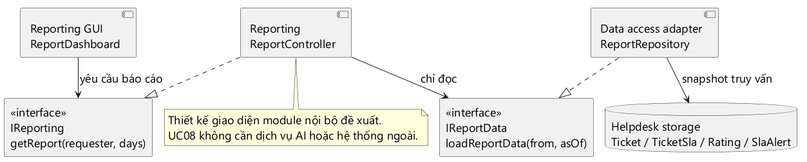
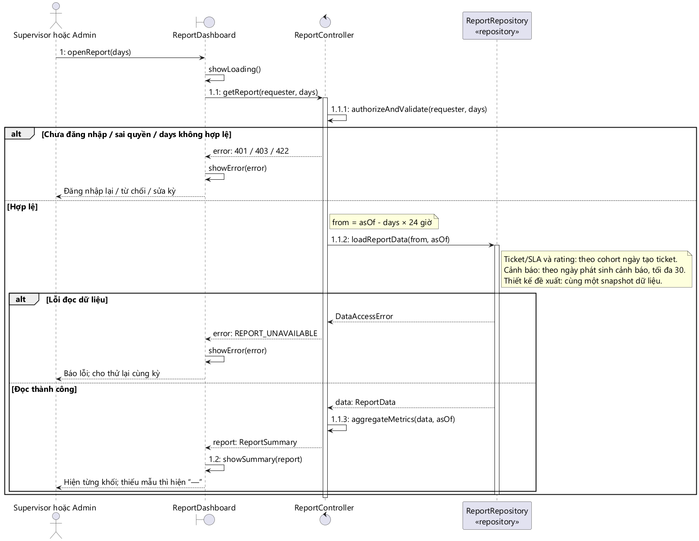
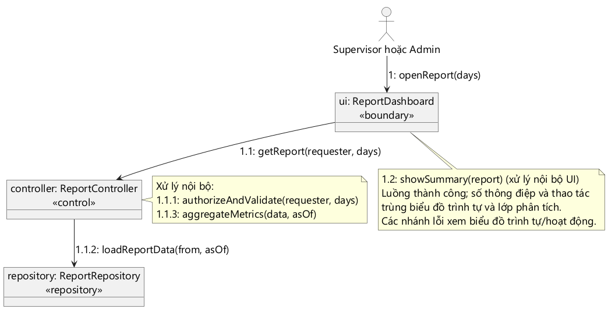
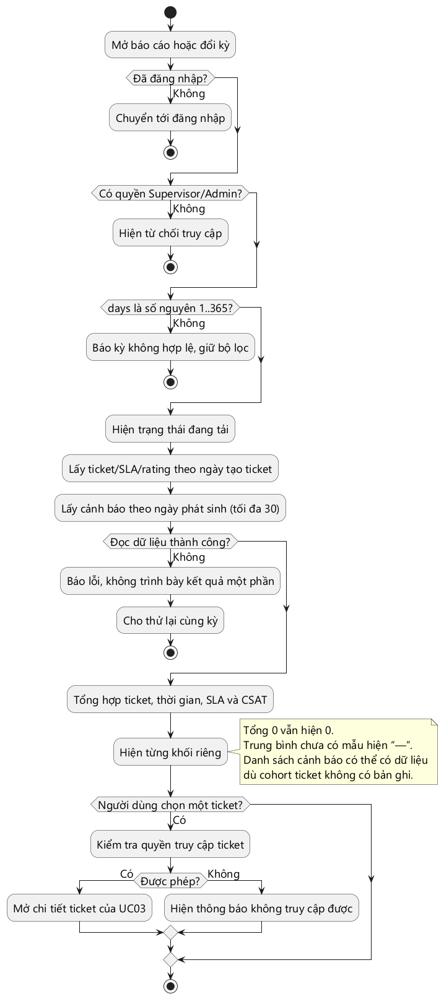
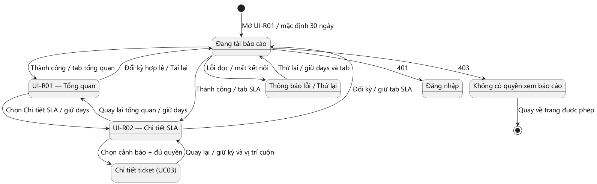
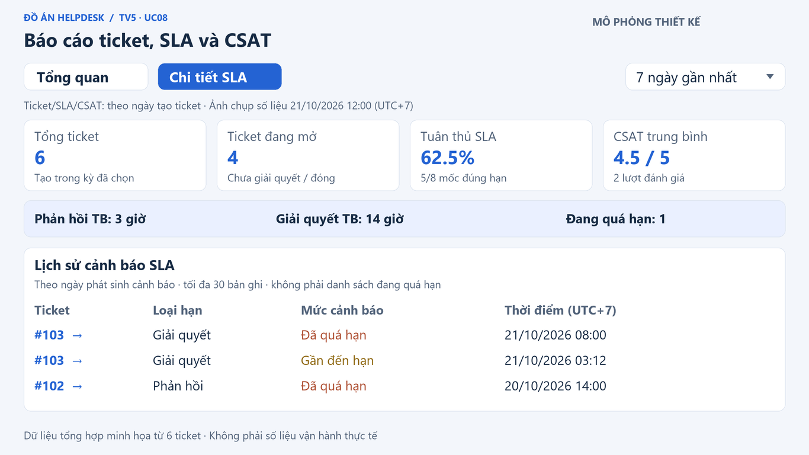
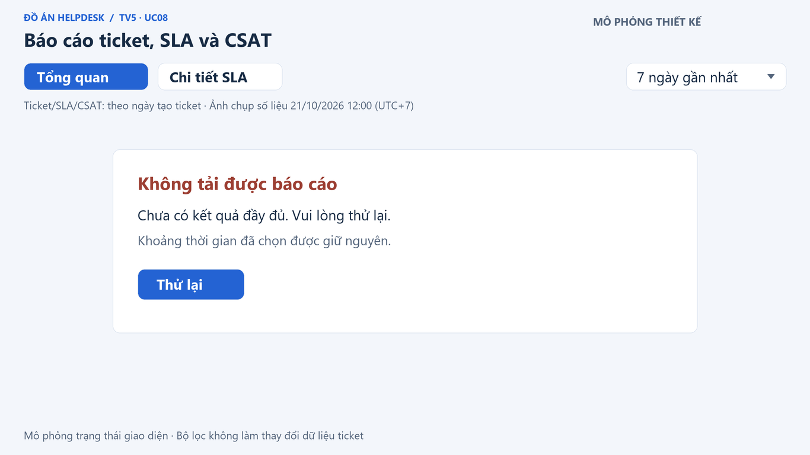
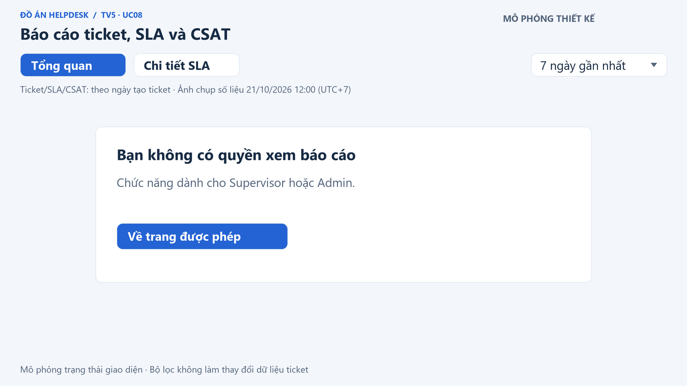

# TV5 — Báo cáo ticket, SLA và CSAT (UC08)

**Đề tài:** Nền tảng Helpdesk đa kênh tích hợp AI  
**Người thực hiện:** TV5 — bổ sung họ tên và MSSV khi nộp.  
**Phiên bản:** 2.0 · Cập nhật 21/10/2026  
**Phạm vi:** Phân tích, thiết kế và đặc tả giao diện UC08; liên kết với bộ tám Use Case của nhóm.

## 1. Căn cứ, phạm vi và sản phẩm

Căn cứ nghiệp vụ là [Chủ đề 07](../Topics-TK%20và%20XD%20phần%20mềm-20261.md) và [kế hoạch nhóm](../Ke-hoach-tuan-1-Use-Case-Chu-de-07.md). Cách tổ chức phân tích tham khảo bài 02 V3 (Phân tích Use Case AIMS) và bài 03 — Interface Design có trên máy làm việc; các bài mẫu cá nhân này không phân phối trong repository Helpdesk. Chưa tìm thấy bài 01 trong workspace nên không khẳng định hồ sơ đã khớp toàn bộ rubric của bài đó.

Hồ sơ gồm sơ đồ tổng thể, sơ đồ Use Case chi tiết UC08, đặc tả luồng, công thức KPI, lớp phân tích, trình tự, giao tiếp, hoạt động, chuyển màn hình, giao diện module và sáu ảnh giao diện. Mỗi sơ đồ có nguồn PlantUML, ảnh PNG để chèn báo cáo và SVG để phóng lớn/in.

Tuần 1 dùng phần Actor, Use Case, phân rã và đặc tả tại mục 2–5. Các mục mô hình lớp, tương tác và giao diện là phần phát triển tiếp theo yêu cầu làm tương tự bài 02–03. Tài liệu tổng thể tám UC chỉ làm bối cảnh; TV5 phụ trách chi tiết UC08.

UC08 chỉ đọc và tổng hợp dữ liệu để Supervisor/Admin đánh giá số lượng ticket, thời gian phản hồi, tuân thủ SLA và CSAT. Tạo ticket, sửa SLA, phát cảnh báo, thu thập rating và xử lý ticket thuộc các UC khác. Không thêm chức năng xuất Excel/PDF hoặc xếp hạng nhân viên vào phạm vi này.

## 2. Actor và Use Case tổng thể

| Actor | Vai trò đối với UC08 |
|---|---|
| Supervisor | Actor chính: mở báo cáo, đổi kỳ, xem thống kê và mở ticket liên quan |
| Admin | Actor chính thay thế: sử dụng cùng mục tiêu báo cáo với quyền toàn hệ thống demo |
| Agent/Khách hàng | Không được xem báo cáo quản trị trong phạm vi đã chọn |
| Hệ thống kênh ngoài | Tham gia tiếp nhận ở UC01–02; không tham gia UC08 |

AI/RAG và bộ lập lịch SLA là xử lý nội bộ. UC08 dùng các mốc SLA và cảnh báo đã có, không gọi AI hoặc bộ lập lịch khi người dùng mở báo cáo.

Nguồn: [PlantUML](TV5-UC08-Bao-cao/use-case-tong-the.puml) · [SVG](TV5-UC08-Bao-cao/use-case-tong-the.svg).

## 3. Phân rã và Use Case chi tiết UC08

Nguồn: [PlantUML](TV5-UC08-Bao-cao/uc08-use-case-chi-tiet.puml) · [SVG](TV5-UC08-Bao-cao/uc08-use-case-chi-tiet.svg).

| Mã chi tiết | Mục tiêu | Quan hệ với UC08 |
|---|---|---|
| UC08.1 | Xem số lượng ticket, đang mở và phân bố trạng thái/danh mục | include: mỗi lần tải báo cáo đều trình bày khối ticket |
| UC08.2 | Xem thời gian phản hồi/giải quyết, tỷ lệ tuân thủ và tình hình SLA | include: khối SLA luôn có, cả khi chưa có mẫu |
| UC08.3 | Xem điểm CSAT và số lượt đánh giá | include: khối CSAT luôn có, cả khi chưa có rating |
| UC08.4 | Mở ticket từ một dòng cảnh báo | extend: sau khi có kết quả và người dùng chọn một ticket |

Các mã UC08.x là phân rã của UC08, không thay đổi danh mục tám UC cấp cao. Mũi tên include đi từ UC08 tới hành vi được bao gồm; extend đi từ UC08.4 tới UC08. Đăng nhập/đủ quyền là tiền điều kiện. Mở chi tiết dùng lại UC03 và phải kiểm tra quyền trên ticket.

Sơ đồ phân rã chức năng toàn hệ thống dưới đây là hình tham khảo bổ sung, dùng để đối chiếu trách nhiệm với các thành viên. Nó không thay thế sơ đồ UML chi tiết ở Hình 2.

Nguồn: [PlantUML](TV5-UC08-Bao-cao/phan-ra-use-case.puml) · [SVG](TV5-UC08-Bao-cao/phan-ra-use-case.svg).

## 4. Đặc tả UC08

| Thuộc tính | Nội dung |
|---|---|
| Mã / tên | UC08 — Xem báo cáo ticket, SLA và CSAT |
| Actor chính | Supervisor hoặc Admin |
| Mục tiêu | Đọc được số liệu hỗ trợ theo kỳ và hiểu được phạm vi/mẫu tính |
| Tiền điều kiện | Actor đã xác thực và được cấp quyền xem báo cáo |
| Kích hoạt | Mở Tổng quan, đổi kỳ hoặc chọn Tải lại |
| Đầu vào | days: số nguyên 1–365; mặc định 30; giao diện cung cấp 7/30/90 ngày |
| Đầu ra | Tổng ticket, đang mở, quá hạn; phân bố trạng thái/danh mục; thời gian trung bình; SLA compliance; CSAT/số rating; tối đa 30 cảnh báo gần nhất |
| Hậu điều kiện thành công | Các khối báo cáo được hiển thị cho cùng yêu cầu; dữ liệu nghiệp vụ không thay đổi |
| Bảo đảm khi lỗi | Không lộ số liệu cho người thiếu quyền; không báo cáo kết quả một phần như đầy đủ |

### 4.1. Luồng chính

1. Actor mở UI-R01 — Tổng quan báo cáo.
2. Giao diện chọn 30 ngày mặc định; nếu đã có bộ lọc trong phiên thì giữ kỳ đã chọn.
3. Giao diện hiển thị trạng thái đang tải và gửi yêu cầu với days.
4. Hệ thống kiểm tra đăng nhập, quyền Supervisor/Admin và days thuộc 1–365.
5. Hệ thống xác định mốc chốt asOf và đầu kỳ from = asOf − days × 24 giờ.
6. Hệ thống lấy ticket tạo từ from, các mốc SLA và rating gắn với những ticket đó.
7. Hệ thống lấy tối đa 30 cảnh báo phát sinh trong kỳ, sắp xếp mới nhất trước.
8. Hệ thống tổng hợp ba khối UC08.1–UC08.3 theo công thức ở mục 5.
9. Giao diện hiển thị các khối, kỳ áp dụng, đơn vị và trạng thái thiếu mẫu ở từng chỉ số.
10. Actor có thể chuyển sang UI-R02 — Chi tiết SLA mà giữ cùng kỳ; nếu chọn một cảnh báo, UC08.4 kiểm tra quyền và mở chi tiết ticket.

### 4.2. Luồng thay thế / ngoại lệ

| Mã | Tại bước | Điều kiện | Xử lý và hậu điều kiện |
|---|---|---|---|
| A1 | 2, 10 | Đổi 7/30/90 ngày | Tải lại cùng tab; chỉ áp dụng kết quả của kỳ chọn mới nhất |
| A2 | 8–9 | Cohort không có ticket | Tổng/đang mở bằng 0, thời gian/SLA/CSAT chưa tính được hiện “—”; vẫn xử lý cảnh báo độc lập |
| A3 | 8–9 | Có ticket nhưng chưa có phản hồi, giải quyết hoặc rating | Chỉ các chỉ số thiếu mẫu hiện “—”; giữ chỉ số khác |
| A4 | 8–9 | Không có mốc SLA đủ điều kiện | SLA = null, hiện “—”; không báo 0% |
| A5 | 10 | Cảnh báo thuộc ticket tạo trước đầu kỳ | Vẫn hiện vì lọc theo ngày cảnh báo; không cộng ticket đó vào tổng cohort |
| E1 | 4 | Chưa đăng nhập/hết phiên | 401; chuyển đăng nhập; không hiển thị số liệu |
| E2 | 4 | Sai vai trò | 403; hiện từ chối; có đường về trang được phép |
| E3 | 4 | days rỗng ở input tùy chỉnh, không nguyên, <1 hoặc >365 | Chỉ rõ lỗi đầu vào; không thực hiện truy vấn báo cáo |
| E4 | 6–8 | Lỗi đọc dữ liệu hoặc mất kết nối | Hiện thông báo lỗi; Thử lại giữ days/tab; không hiển thị kết quả chưa đầy đủ |
| E5 | 10 | Ticket không còn tồn tại/không đủ quyền | Không mở nội dung; giữ báo cáo và thông báo không truy cập được |

### 4.3. Đặc tả bốn UC con

| UC | Kích hoạt / điều kiện | Luồng thành công | Ngoại lệ / kết quả |
|---|---|---|---|
| UC08.1 | UC08 đã xác thực kỳ và quyền | 1. Lấy cohort. 2. Đếm tổng/đang mở. 3. Nhóm theo trạng thái/danh mục. 4. Trả số lượng | Không có ticket: tổng 0; danh mục chưa xác định hiển thị riêng, không làm mất ticket |
| UC08.2 | Cùng cohort UC08.1 và mốc chốt | 1. Lấy SLA từng ticket. 2. Tính trung bình. 3. Xét các mốc đến hạn/hoàn tất. 4. Tính tuân thủ, đang quá hạn. 5. Lấy cảnh báo theo kỳ phát sinh | Mẫu số 0: null. Mốc chưa đến hạn/chưa hoàn tất: loại khỏi mẫu số. Cảnh báo lịch sử không đồng nhất với số ticket đang quá hạn |
| UC08.3 | Cùng cohort UC08.1 | 1. Lấy rating hợp lệ của cohort. 2. Đếm lượt. 3. Tính trung bình điểm 1–5. 4. Trả điểm và số lượt | Không có rating: null và 0 lượt; không giả thành điểm 0 |
| UC08.4 | Người dùng chọn ticket sau khi đã có báo cáo | 1. Nhận ticketId từ dòng cảnh báo. 2. Kiểm tra lại quyền. 3. Mở màn chi tiết UC03. 4. Quay lại giữ kỳ/tab | 403/404: báo không truy cập được, không hiện dữ liệu ticket; bộ lọc vẫn giữ |

## 5. Quy tắc KPI, dữ liệu và ví dụ đối chiếu

### 5.1. Phạm vi thời gian

KPI ticket/SLA/CSAT dùng cohort ticket theo **ngày tạo ticket**, không lọc rating theo ngày gửi đánh giá. Ngày chốt và múi giờ hiển thị cần ghi rõ. Prototype hiện dùng cửa sổ ngày lùi từ thời điểm gọi API; quy tắc demo là 24/7, WAITING_CUSTOMER vẫn tính SLA, mở lại dùng hạn ban đầu.

Bảng cảnh báo dùng **ngày phát sinh cảnh báo**, độc lập với cohort trên và giới hạn 30 bản ghi mới nhất. Do đó có thể có tổng ticket bằng 0 nhưng vẫn có cảnh báo trong kỳ từ ticket cũ. Không dùng số dòng cảnh báo làm số ticket đang quá hạn.

### 5.2. Công thức

| Chỉ số | Công thức / đơn vị | Thiếu mẫu |
|---|---|---|
| Tổng ticket | Số ticket trong cohort | 0 |
| Đang mở | Trạng thái khác RESOLVED/CLOSED | 0 |
| Phản hồi đầu tiên TB | Tổng(first_response_at − created_at) / số ticket có first_response_at; API trả giây | null → “—” |
| Giải quyết TB | Tổng(resolved_at − created_at) / số ticket có resolved_at | null → “—” |
| SLA compliance | 100 × số mốc đúng hạn / số mốc đủ điều kiện; mỗi ticket tối đa hai mốc phản hồi/giải quyết | Mẫu số 0 → null |
| CSAT | Tổng điểm / số rating hợp lệ; thang 1–5, làm tròn một chữ số thập phân khi hiển thị | null và 0 lượt |
| Đang quá hạn | Ticket chưa có actual và đã vượt due của ít nhất một mốc; mỗi ticket chỉ đếm một lần | 0 |

Mốc SLA đủ điều kiện khi đã có actual hoặc due ≤ asOf. Đúng hạn khi actual tồn tại và actual ≤ due. Tin PENDING/FAILED/CANCELLED, ghi chú nội bộ và thư xác nhận tiếp nhận không tính là phản hồi hữu ích đã gửi. Tự động FAQ được tính sau gửi thành công theo quy tắc của nhóm. Ticket phản hồi trễ nhưng đã phản hồi vẫn có mốc SLA vi phạm, dù không còn “đang quá hạn phản hồi”.

CSAT ở đây là **điểm trung bình**, không phải phần trăm khách hài lòng. Nếu nhóm đổi sang tỷ lệ 4–5 sao thì cần đổi nhãn, công thức và đặc tả cùng lúc.

### 5.3. Dữ liệu minh họa có thể tính lại

Bộ [sample-report.json](TV5-UC08-Bao-cao/sample-report.json) chứa sáu ticket tổng hợp với các thời điểm đầy đủ. Mốc chốt: **21/10/2026 12:00 UTC+7**; kỳ 7 ngày. Mọi ticket trong ví dụ dùng SLA phản hồi 4 giờ/giải quyết 24 giờ.

| Ticket | Trạng thái | Phản hồi sau | Giải quyết sau | Kết quả mốc phản hồi / giải quyết | Rating |
|---|---|---:|---:|---|---:|
| #101 | CLOSED | 1 giờ | 8 giờ | Đúng / đúng | 5 |
| #102 | RESOLVED | 5 giờ | 20 giờ | Trễ / đúng | 4 |
| #103 | IN_PROGRESS | 2 giờ | Chưa | Đúng / đã quá hạn | — |
| #104 | WAITING_CUSTOMER | 6 giờ | Chưa | Trễ / chưa đến hạn | — |
| #105 | NEW | Chưa | Chưa | Chưa đến hạn / chưa đến hạn | — |
| #106 | IN_PROGRESS | 1 giờ | Chưa | Đúng / chưa đến hạn | — |

Kết quả tính lại: tổng **6**, đang mở **4**, đang quá hạn **1**; phản hồi TB (1+5+2+6+1)/5 = **3 giờ**; giải quyết TB (8+20)/2 = **14 giờ**; tuân thủ **5/8 = 62,5%**; CSAT **(5+4)/2 = 4,5/5, hai lượt**. Các danh mục có 2 ticket mỗi nhóm. Trạng thái 1 mới + 2 đang xử lý + 1 chờ khách + 1 giải quyết + 1 đóng = 6.

Các hình GUI tại mục 8 được sinh từ chính dữ liệu này. [sample-metrics.json](TV5-UC08-Bao-cao/sample-metrics.json) lưu kết quả tính; đây là minh họa kiểm tra công thức, không phải số liệu vận hành.

## 6. Phân tích lớp và giao diện module — theo bài 02/03

### 6.1. Trách nhiệm và mô hình lớp

| Thành phần | Loại | Trách nhiệm |
|---|---|---|
| ReportDashboard | Boundary | Nhận kỳ, hiển thị đang tải, báo cáo/lỗi; điều hướng mở ticket |
| ReportController | Control | Kiểm tra quyền/tham số, phối hợp lấy dữ liệu, tổng hợp KPI |
| ReportRepository | Repository đề xuất | Đọc dữ liệu ticket/SLA/rating/cảnh báo; trả ReportData |
| Ticket, TicketSla | Entity | Trạng thái, thời điểm tạo, actual/due của phản hồi và giải quyết |
| Rating, SlaAlert | Entity | Điểm đánh giá, lịch sử cảnh báo |
| ReportData, ReportSummary | DTO | Dữ liệu đọc và kết quả tổng hợp; không phải bảng nghiệp vụ mới |

Nguồn: [PlantUML](TV5-UC08-Bao-cao/uc08-analysis-class.puml) · [SVG](TV5-UC08-Bao-cao/uc08-analysis-class.svg).

Ticket liên kết một TicketSla, tối đa một Rating và nhiều SlaAlert. DTO là nhóm dữ liệu tạm cho lần đọc. ReportRepository/ReportController là **lớp đề xuất**, chưa phải lớp đang tồn tại trong code: prototype hiện thực truy vấn và tính toán trực tiếp trong hàm reports() tại [main.py](../helpdesk/app/main.py).

### 6.2. Giao diện module nội bộ

Nguồn: [PlantUML](TV5-UC08-Bao-cao/uc08-report-components.puml) · [SVG](TV5-UC08-Bao-cao/uc08-report-components.svg).

| Hợp đồng đề xuất | Điều kiện vào | Kết quả / lỗi |
|---|---|---|
| IReporting.getReport(requester, days) | Requester xác thực, được cấp quyền; days nguyên 1–365 | ReportSummary; lỗi xác thực/quyền/tham số hoặc REPORT_UNAVAILABLE |
| IReportData.loadReportData(from, asOf) | Đã kiểm tra quyền ở tầng ứng dụng; from ≤ asOf | ReportData nhất quán trong lần đọc; lỗi DataAccessError |

Thiết kế đề xuất đọc trên một snapshot dữ liệu để tránh các khối lệch nhau do ticket đổi giữa các truy vấn. Prototype hiện có nhiều truy vấn trực tiếp, chưa được xem là đã hiện thực yêu cầu snapshot này. Tên lỗi REPORT_UNAVAILABLE/DataAccessError là hợp đồng thiết kế, không phải mã API đã triển khai.

UC08 không có subsystem bên ngoài tương tự Interbank của AIMS. Phần áp dụng bài 03 là xác định interface và phụ thuộc module báo cáo nội bộ; không tạo dịch vụ ngoài khi nghiệp vụ không cần.

## 7. Biểu đồ tương tác và hoạt động

### 7.1. Biểu đồ trình tự

Nguồn: [PlantUML](TV5-UC08-Bao-cao/uc08-sequence.puml) · [SVG](TV5-UC08-Bao-cao/uc08-sequence.svg).

Biểu đồ bao gồm luồng thành công và nhánh sai quyền/tham số, lỗi đọc dữ liệu. Thiếu mẫu là trạng thái từng khối, không phải điều kiện xóa toàn bộ báo cáo.

### 7.2. Biểu đồ giao tiếp

Nguồn: [PlantUML](TV5-UC08-Bao-cao/uc08-communication.puml) · [SVG](TV5-UC08-Bao-cao/uc08-communication.svg).

| Số | Thông điệp | Lớp nhận khai báo thao tác |
|---|---|---|
| 1 | openReport(days) | ReportDashboard |
| 1.1 | getReport(requester, days) | ReportController |
| 1.1.1 | authorizeAndValidate(requester, days) | ReportController, tự gọi |
| 1.1.2 | loadReportData(from, asOf) | ReportRepository |
| 1.1.3 | aggregateMetrics(data, asOf) | ReportController, tự gọi |
| 1.2 | showSummary(report) | ReportDashboard, tự gọi |

Luồng lỗi dùng showError(error); showLoading() thể hiện phản hồi lúc chờ. Các tự gọi được ghi bằng note ở sơ đồ giao tiếp để giữ chữ dễ đọc; không phải lời gọi tới một đối tượng khác.

### 7.3. Biểu đồ hoạt động

Nguồn: [PlantUML](TV5-UC08-Bao-cao/uc08-activity.puml) · [SVG](TV5-UC08-Bao-cao/uc08-activity.svg).

## 8. Thiết kế giao diện chi tiết — theo bài 03

### 8.1. Quy chuẩn GUI

| Mã | Quy chuẩn |
|---|---|
| G01 | Mockup desktop 1366 × 768; bố cục dùng lề 40 px, khoảng cách 16–18 px; màn hẹp xếp KPI thành cột, bảng có vùng cuộn ngang riêng |
| G02 | Segoe UI; tiêu đề 32 px, chữ nội dung 22–24 px, chú thích 18 px; màu chính xanh #2463D3, chữ #172B44, nền #F3F6FB |
| G03 | Số liệu luôn có nhãn và đơn vị; màu trạng thái có chữ đi kèm; null hiển thị “—”, tổng thực bằng 0 hiển thị 0 |
| G04 | Kỳ mặc định 30 ngày; các mockup dùng kỳ 7 ngày để đối chiếu bộ dữ liệu minh họa; đổi tab giữ kỳ |
| G05 | Đổi kỳ/Tải lại hiển thị đang tải; bỏ kết quả đến muộn của kỳ cũ; tránh trộn các khối của hai yêu cầu |
| G06 | Số tỷ lệ và điểm làm tròn một chữ số thập phân; thời gian API là giây, GUI đổi sang phút/giờ phù hợp; không làm tròn trước khi tổng hợp |
| G07 | Ngày giờ hiển thị dd/MM/yyyy HH:mm, UTC+7; không dùng màu làm dấu hiệu duy nhất |
| G08 | Tab/Shift+Tab đi tới chọn kỳ → tab báo cáo → tải lại/thử lại → dòng ticket; Enter kích hoạt; thông báo lỗi có nội dung rõ và hỗ trợ screen reader |
| G09 | Sai quyền không hiện KPI; hết phiên về đăng nhập; lỗi mạng giữ kỳ/tab và nút Thử lại |
| G10 | Đây là thiết kế giao diện đề xuất. Việc một chi tiết có trong mockup không khẳng định prototype đã hiện thực chi tiết đó |

### 8.2. Danh mục và luồng màn hình

| Mã | Màn hình | Điều kiện mở / lối ra |
|---|---|---|
| UI-R01 | Tổng quan ticket, SLA, CSAT | Sau kiểm tra quyền; đổi kỳ, chuyển UI-R02 |
| UI-R02 | Chi tiết SLA và cảnh báo | Từ UI-R01, giữ kỳ; chọn ticket sang màn UC03 |
| UI-TICKET | Chi tiết ticket (tham chiếu UC03) | Kiểm tra quyền theo ticket; quay lại UI-R02 giữ kỳ và vị trí cuộn |

Nguồn: [PlantUML](TV5-UC08-Bao-cao/uc08-screen-flow.puml) · [SVG](TV5-UC08-Bao-cao/uc08-screen-flow.svg).

### 8.3. Mockup UI-R01 — Tổng quan

### 8.4. Mockup UI-R02 — Chi tiết SLA

“Đang quá hạn: 1” là số ticket chưa hoàn tất mốc đã vượt hạn. Ba dòng bên dưới là lịch sử cảnh báo của hai ticket, gồm cả cảnh báo đã được xử lý; hai đại lượng không cần bằng nhau.

### 8.5. Đặc tả control và thao tác

| Mã | Control | Sự kiện | Xử lý / kết quả |
|---|---|---|---|
| SEL-R01 | Chọn kỳ 7/30/90 ngày | Change | Cập nhật days, tải lại tab hiện tại; chỉ áp dụng kết quả mới nhất |
| TAB-R01 | Tổng quan | Click/Enter | Mở UI-R01 với days hiện có |
| TAB-R02 | Chi tiết SLA | Click/Enter | Mở UI-R02 với days hiện có |
| ACT-R01 | Tải lại / mở lại trang | Refresh | Gọi lại báo cáo cùng kỳ, cập nhật thời điểm lấy số liệu sau thành công |
| BTN-R01 | Thử lại | Click/Enter sau lỗi | Giữ kỳ/tab; hiển thị đang tải, không gửi thay đổi nghiệp vụ |
| LINK-R01 | Mã ticket ở bảng cảnh báo | Click/Enter | UC08.4: kiểm tra quyền, mở chi tiết; lỗi giữ màn báo cáo |
| BTN-R02 | Về trang được phép | Click/Enter sau 403 | Quay về màn phù hợp vai trò, không hiển thị báo cáo |

### 8.6. Đặc tả trường dữ liệu

| Mã | Trường | Kiểu / miền | Thuộc tính | Định dạng / quy tắc |
|---|---|---|---|---|
| F01 | days | Integer 1–365 | Chọn; mặc định 30 | GUI chuẩn có 7/30/90; input tùy chỉnh nếu bổ sung phải kiểm tra miền trước gửi |
| F02 | total / open / overdue | Integer ≥0 | Chỉ đọc | Không có ticket là 0; open không gồm RESOLVED/CLOSED |
| F03 | avg_response_seconds | Decimal ≥0 hoặc null | Chỉ đọc | Phút/giờ, có nhãn phản hồi; null → “—” |
| F04 | avg_resolution_seconds | Decimal ≥0 hoặc null | Chỉ đọc | Phút/giờ; null → “—” |
| F05 | sla_compliance | Decimal 0–100 hoặc null | Chỉ đọc | Một chữ số thập phân + %; nhãn định nghĩa mẫu số |
| F06 | csat / rating_count | Decimal 1–5 hoặc null / Integer ≥0 | Chỉ đọc | x/5 và số lượt; chưa có mẫu là “—”/0 |
| F07 | statuses | Map trạng thái → Integer ≥0 | Chỉ đọc | Đủ năm trạng thái, giá trị vắng coi 0; tổng bằng total |
| F08 | categories | Map danh mục → Integer ≥0 | Chỉ đọc | Kèm Chưa phân loại nếu cần để tổng bằng total |
| F09 | alerts | List, tối đa 30 | Chỉ đọc | ticket_id, deadline_type, level, created_at; không hiển thị nội dung hội thoại |
| F10 | ticket_id | Integer >0 | Liên kết | Kiểm tra quyền khi mở; không coi có ID trong báo cáo là quyền đọc mọi ticket |
| F11 | created_at của cảnh báo | DateTime | Chỉ đọc | dd/MM/yyyy HH:mm, UTC+7; sắp xếp giảm dần |
| F12 | asOf / kỳ hiển thị | DateTime / số ngày | Chỉ đọc, thiết kế đề xuất | Phân biệt thời điểm đọc báo cáo với ngày phát sinh từng cảnh báo |

asOf, số mẫu thời gian và số mốc đúng hạn trong mockup là thông tin thiết kế bổ sung. API hiện tại trả phần trăm/trung bình nhưng chưa trả riêng tất cả các mẫu số này; cần bổ sung hợp đồng khi hiện thực thiết kế GUI.

### 8.7. Các trạng thái giao diện

Trạng thái chưa có rating hoặc mốc SLA áp dụng độc lập theo từng thẻ. Tải rỗng thành công không dùng thông báo lỗi. Khi đang tải hoặc lỗi, không hiển thị số liệu cũ dưới nhãn kỳ mới.

## 9. Đối chiếu với prototype và hợp đồng API

API hiện có: GET /api/reports?days=30. Quyền Supervisor/Admin; days 1–365. Dữ liệu trả về gồm total, open, overdue, avg_response_seconds, avg_resolution_seconds, sla_compliance, csat, rating_count, statuses, categories, alerts.

| Thành phần | Hiện trạng đọc từ code | Thiết kế hồ sơ |
|---|---|---|
| Tính KPI/cohort và giới hạn 30 cảnh báo | Có trong hàm reports() | Giữ công thức/phạm vi, giải thích rõ hai loại cửa sổ thời gian |
| Controller/Repository riêng | Chưa có lớp riêng | Đề xuất tách trách nhiệm như Hình 4–7 |
| Snapshot nhất quán các truy vấn | Chưa được bảo đảm bởi thiết kế truy vấn hiện tại | Đề xuất đọc cùng snapshot và cùng asOf |
| asOf, số mẫu/mẫu số trên GUI | Chưa có đủ trong response | Thêm metadata khi thực hiện thiết kế GUI |
| Danh mục chưa phân loại | API đếm các danh mục có cấu hình, có thể bỏ ticket null | Thiết kế bổ sung nhóm Chưa phân loại để tổng số khớp |
| Lỗi, request đến muộn và trạng thái GUI chi tiết | Không coi là đã nghiệm thu trong đợt tài liệu này | Mô tả đầy đủ trạng thái và yêu cầu chấp nhận |

Các lỗi 401/403/422 gắn với xác thực/quyền/validation của prototype. Mã REPORT_UNAVAILABLE và DataAccessError trong sơ đồ là tên lỗi ở mức thiết kế. Tên thuộc tính camelCase trên mô hình được ánh xạ sang snake_case khi trao đổi JSON.

## 10. Kịch bản nghiệm thu đề xuất

| Mã | Tình huống | Kết quả mong đợi |
|---|---|---|
| AC01 | Supervisor/Admin mở báo cáo | Đọc được ba khối; kỳ mặc định 30, API cho 1–365 |
| AC02 | Agent/Customer/chưa đăng nhập gọi báo cáo | Từ chối theo quyền/phiên; không trả số liệu |
| AC03 | Chọn kỳ khác khi yêu cầu trước chưa xong | Hiển thị đúng kỳ mới nhất, không trộn dữ liệu |
| AC04 | Không có ticket hoặc rating | 0 cho đếm; null/“—” cho KPI thiếu mẫu; số rating chính xác |
| AC05 | Dùng dữ liệu sáu ticket tại mục 5.3 | 6 tổng, 4 mở, 1 quá hạn, 3h/14h, 62,5%, 4,5/5 với 2 rating |
| AC06 | Ticket cũ có cảnh báo mới trong kỳ | Có dòng cảnh báo nhưng không cộng vào tổng cohort |
| AC07 | Tin nhắn gửi lỗi / ghi chú nội bộ | Không được tính là phản hồi đầu tiên đã gửi |
| AC08 | Lỗi đọc/mất kết nối | Giữ kỳ/tab, thông báo lỗi và Thử lại; không báo thành công một phần |
| AC09 | Mở ticket bị thu hồi quyền hoặc đã xóa | Không hiện nội dung; có thông báo; báo cáo vẫn giữ bộ lọc |

Đây là kịch bản nghiệm thu để nhóm áp dụng cho phần mềm sau khi hiện thực thiết kế. Đợt hoàn thiện hồ sơ này kiểm tra sơ đồ, hình ảnh và số liệu minh họa; không tuyên bố đã chạy các kịch bản phần mềm mới trên prototype.

## 11. Kết quả review và việc nhóm cần xác nhận

| Vấn đề review trước | Kết quả hoàn thiện |
|---|---|
| Thiếu Use Case chi tiết UC08 | Đã có Hình 2 với Actor, ranh giới, include/extend và đặc tả UC08.x |
| Thông điệp không khớp thao tác lớp | Đã thống nhất openReport, getReport, authorizeAndValidate, loadReportData, aggregateMetrics, showSummary |
| Gọi Repository là lớp đã có trong code | Đã ghi rõ là thiết kế đề xuất, đối chiếu prototype tại mục 9 |
| GUI chỉ là wireframe | Đã có quy chuẩn, chuyển màn hình, control, trường dữ liệu và sáu mockup PNG |
| Chưa xuất ảnh/kiểm tra render | Đã xuất chín sơ đồ PNG/SVG, xem trực tiếp ảnh và chỉnh lỗi chữ/bố cục |
| Số wireframe không kiểm tra được | Đã dùng một bộ sáu ticket nhất quán, có dữ liệu gốc và script tính/sinh hình |

Các thông tin còn cần nhóm cung cấp/xác nhận: họ tên/MSSV TV5; người review/duyệt thật; công thức cohort, CSAT trung bình và quyền Admin; mẫu bài 01 khi có; định dạng nộp cuối cùng và yêu cầu dùng Astah nếu giảng viên quy định. Không tự ghi tên reviewer hoặc đánh dấu nhóm đã nghiệm thu.

## 12. Danh mục nguồn và cách tái tạo hình

Chín file .puml nằm trong [thư mục sơ đồ](TV5-UC08-Bao-cao/uc08-use-case-chi-tiet.puml): use-case-tong-the, phan-ra-use-case, uc08-use-case-chi-tiet, uc08-analysis-class, uc08-sequence, uc08-communication, uc08-activity, uc08-screen-flow, uc08-report-components. Mỗi file có bản .png và .svg cùng tên.

Sáu mockup giao diện sinh bởi [render_mockups.py](TV5-UC08-Bao-cao/render_mockups.py); dữ liệu từ sample-report.json. Script chỉ đọc dữ liệu minh họa và ghi ảnh/kết quả vào thư mục này, không kết nối DB ứng dụng.

Tái tạo toàn bộ (cần Java, PlantUML 1.2024.8 và Python có Pillow):

~~~powershell
.\docs\TV5-UC08-Bao-cao\render_all.ps1 -PlantUmlJar 'C:\tools\plantuml-1.2024.8.jar' -JavaPath 'C:\Program Files\Java\jdk-23\bin\java.exe'
~~~

Nếu chỉ cần tái tạo mockup: chạy python docs/TV5-UC08-Bao-cao/render_mockups.py. Nguồn PlantUML giữ lại để chỉnh sửa; PNG dùng chèn Word, SVG dùng phóng to. Đây là mô hình UML và mockup thiết kế; chuyển sang dự án Astah cần dựng/import bằng công cụ nhóm sử dụng.
