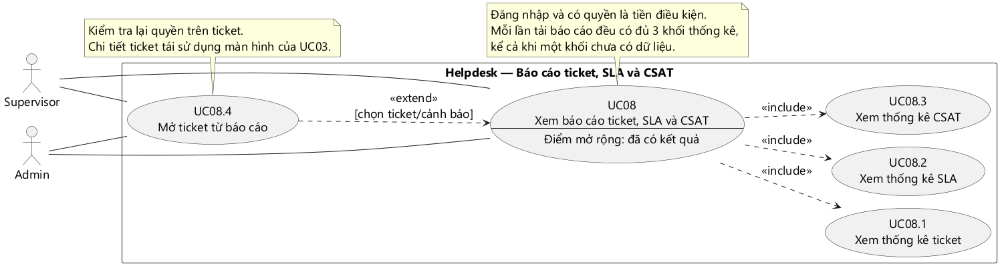
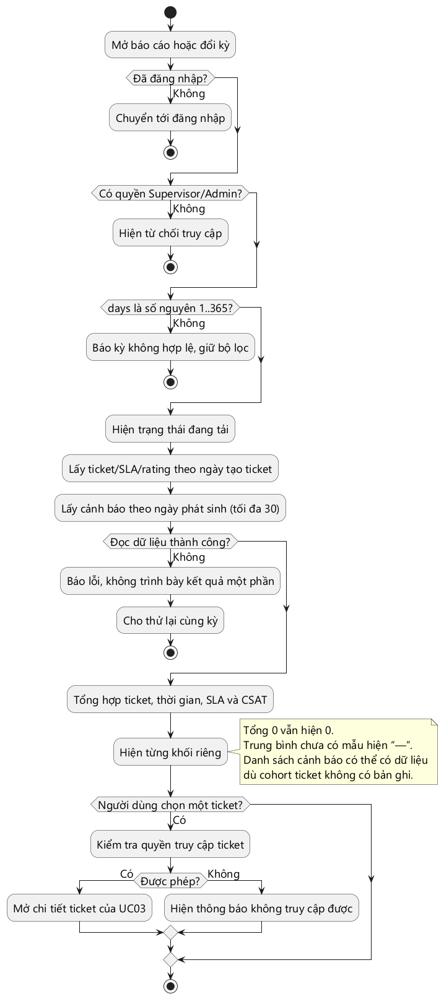

# BÁO CÁO PHÂN TÍCH THIẾT KẾ USE CASE — TUẦN 1
## UC08: Xem báo cáo ticket, SLA và CSAT

* **Đề tài:** Nền tảng Helpdesk đa kênh tích hợp AI (Chủ đề 07)
* **Thành viên phụ trách:** TV5 — Báo cáo & Thống kê / Tổng hợp tài liệu nhóm
* **Giai đoạn:** Tuần 1 — Khảo sát yêu cầu, xác định Actor, phân rã và đặc tả Use Case
* **Tài liệu tham chiếu:** [Kế hoạch tuần 1](../K%E1%BA%BF%20ho%E1%BA%A1ch%20tu%E1%BA%A7n%201.md)

---

## 1. Xác định Actor và Mục tiêu của UC08

### 1.1. Actor liên quan
* **Actor chính: Trưởng nhóm (Supervisor)**  
  * Là người chịu trách nhiệm trực tiếp giám sát tiến độ và chất lượng phục vụ của nhóm hỗ trợ.  
  * Sử dụng báo cáo để đánh giá năng suất tiếp nhận ticket, tỷ lệ trễ hạn SLA của nhóm và mức độ hài lòng của khách hàng (CSAT).
* **Actor thay thế: Quản trị viên (Admin)**  
  * Có quyền truy cập cấp cao, theo dõi các chỉ số tổng thể trên toàn hệ thống để lập kế hoạch phân bổ nguồn lực.
* **Các đối tượng không tham gia:**  
  * Khách hàng (Customer) và Nhân viên hỗ trợ (Agent) thông thường không có quyền truy cập vào màn hình báo cáo quản trị này.  
  * AI/RAG và Bộ lập lịch chạy ngầm là các tác vụ nội bộ, không đóng vai trò Actor trong UC08.

### 1.2. Mục tiêu nghiệp vụ
* Cung cấp cái nhìn toàn diện theo các khoảng thời gian linh hoạt (7 ngày, 30 ngày, 90 ngày) về:
  1. Số lượng ticket tiếp nhận và tình trạng xử lý tồn đọng.
  2. Thời gian phản hồi, thời gian giải quyết và mức độ tuân thủ cam kết SLA.
  3. Chỉ số hài lòng CSAT của khách hàng sau khi ticket được đóng.
* Hỗ trợ phát hiện nhanh các nguy cơ trễ hạn (SLA Warnings/Breaches) để kịp thời điều phối công việc.

---

## 2. Sơ đồ Use Case chi tiết UC08 (Use Case Diagram)

Use Case **UC08** được phân rã thành các hành vi chức năng con nhằm phân định rõ từng khối thông tin nghiệp vụ:

### Phân rã các hành vi con:
* **UC08.1 — Xem số lượng ticket và phân bố trạng thái (`«include»`):**  
  Thống kê tổng số ticket phát sinh trong kỳ, số ticket đang mở (`NEW`, `IN_PROGRESS`, `WAITING_CUSTOMER`) và tỷ lệ phân bổ theo trạng thái, danh mục.
* **UC08.2 — Xem chỉ số thời gian và tuân thủ SLA (`«include»`):**  
  Hiển thị thời gian phản hồi đầu tiên trung bình, thời gian giải quyết trung bình, tỷ lệ phần trăm đạt SLA và danh sách các cảnh báo trễ hạn.
* **UC08.3 — Xem điểm CSAT và số lượt đánh giá (`«include»`):**  
  Hiển thị điểm đánh giá hài lòng trung bình (thang điểm 1–5) và số lượng khách hàng đã tham gia khảo sát.
* **UC08.4 — Mở xem chi tiết ticket từ cảnh báo (`«extend»`):**  
  Hành vi tùy chọn khi Supervisor muốn nhấp vào một dòng ticket bị cảnh báo trễ hạn trên báo cáo để chuyển sang màn hình xử lý chi tiết (kết nối với UC03).

*(Mã nguồn PlantUML tham khảo tại [uc08-use-case-chi-tiet.puml](TV5-UC08-Bao-cao/uc08-use-case-chi-tiet.puml)).*

---

## 3. Biểu đồ hoạt động (Activity Diagram)

Biểu đồ mô tả trực quan luồng xử lý nghiệp vụ từ khi Actor yêu cầu xem báo cáo cho đến khi hệ thống tính toán và hiển thị dữ liệu (hoặc xử lý rẽ nhánh khi phát sinh lỗi/thiếu quyền):

### Tóm tắt luồng hoạt động:
1. **Khởi tạo:** Actor chọn khoảng thời gian cần thống kê (mặc định 30 ngày, hoặc chọn nhanh 7 / 90 ngày).
2. **Kiểm tra quyền truy cập:** Hệ thống xác thực danh tính và thẩm quyền (chỉ cho phép Supervisor hoặc Admin). Nếu không hợp lệ $\rightarrow$ hiển thị thông báo lỗi 401/403 và dừng.
3. **Thu thập dữ liệu:** Hệ thống truy vấn tập hợp ticket được tạo trong kỳ chọn (cohort), cùng các mốc hạn SLA và điểm đánh giá tương ứng. Đồng thời lấy lịch sử cảnh báo phát sinh.
4. **Tính toán chỉ số:** Thực hiện tính toán tổng ticket, trung bình thời gian, tỷ lệ % SLA và điểm CSAT theo quy tắc chuẩn.
5. **Hiển thị:** Trình bày bảng điều khiển báo cáo. Trường hợp chưa có đủ mẫu dữ liệu, hệ thống hiển thị ký hiệu `"—"` thay vì hiển thị giá trị 0 sai lệch.

*(Mã nguồn PlantUML tham khảo tại [uc08-activity.puml](TV5-UC08-Bao-cao/uc08-activity.puml)).*

---

## 4. Bản đặc tả Use Case UC08 (Chuẩn theo Biểu mẫu Mục 8)

| Thuộc tính | Nội dung chi tiết |
| :--- | :--- |
| **Mã / Tên Use Case** | **UC08 – Xem báo cáo ticket, SLA và CSAT** |
| **Actor chính / Actor phụ** | • Actor chính: Trưởng nhóm (Supervisor) • Actor thay thế: Quản trị viên (Admin) |
| **Mục tiêu** | Đọc, theo dõi và nắm bắt các số liệu vận hành hỗ trợ theo kỳ để đánh giá năng suất đội ngũ và chất lượng phục vụ khách hàng. |
| **Tiền điều kiện** | Người dùng đã đăng nhập thành công vào hệ thống và có vai trò là Supervisor hoặc Admin. |
| **Sự kiện kích hoạt** | Người dùng mở trang "Báo cáo thống kê", chọn thay đổi kỳ thời gian hoặc nhấn nút "Tải lại". |
| **Luồng chính (Main Flow)** | 1. Actor truy cập vào giao diện Báo cáo thống kê. 2. Giao diện thiết lập kỳ mặc định là 30 ngày (hoặc kỳ đã chọn trước đó trong phiên). 3. Giao diện hiển thị trạng thái đang tải và gửi yêu cầu truy vấn đến hệ thống. 4. Hệ thống kiểm tra phiên đăng nhập và quyền xem báo cáo của Actor. 5. Hệ thống xác định khoảng thời gian cần lọc và truy vấn dữ liệu các ticket, mốc thời gian SLA, điểm đánh giá và lịch sử cảnh báo trong kỳ. 6. Hệ thống thực hiện tổng hợp các chỉ số (tổng số lượng, phân bố trạng thái, thời gian phản hồi/giải quyết trung bình, tỷ lệ % đạt SLA, điểm CSAT). 7. Giao diện hiển thị toàn bộ các khối số liệu thống kê kèm đơn vị rõ ràng; bảng cảnh báo liệt kê các trường hợp trễ hạn gần nhất. |
| **Luồng thay thế / Ngoại lệ (Alternative & Exception Flows)** | • **A1 - Đổi kỳ thời gian:** Tại bước 7, Actor có thể chọn nhanh mốc 7 ngày hoặc 90 ngày; hệ thống thực hiện lại từ bước 3 với khoảng thời gian mới. • **A2 - Nhóm dữ liệu chưa có ticket (Kỳ trống):** Hệ thống hiển thị tổng ticket = 0, đang mở = 0; các chỉ số thời gian, SLA và CSAT hiển thị ký hiệu `"—"` (chưa có mẫu). • **A3 - Có ticket nhưng chưa có đánh giá hoặc chưa giải quyết:** Chỉ số tương ứng thiếu mẫu hiển thị ký hiệu `"—"`, không làm ảnh hưởng đến các khối chỉ số khác. • **A4 - Xem chi tiết sự cố:** Actor nhấp vào một ticket trong danh sách cảnh báo SLA $\rightarrow$ hệ thống điều hướng mở màn hình chi tiết ticket (kích hoạt UC08.4 mở UC03). • **E1 - Hết phiên đăng nhập:** Hệ thống trả về lỗi 401 và chuyển hướng Actor về màn hình đăng nhập. • **E2 - Không đủ quyền hạn:** Nếu tài khoản không thuộc vai trò Supervisor hoặc Admin, hệ thống từ chối truy cập (403) và thông báo lỗi. • **E3 - Lỗi kết nối / Truy vấn CSDL thất bại:** Hệ thống giữ nguyên giao diện hiện tại, hiển thị thông báo lỗi và cung cấp nút "Thử lại". |
| **Hậu điều kiện** | Các khối số liệu báo cáo được hiển thị đầy đủ, đồng bộ theo đúng khoảng thời gian đã chọn. Dữ liệu gốc trong hệ thống không bị thay đổi (chế độ chỉ đọc). |
| **Quy tắc nghiệp vụ & Chỉ số cần xem** | 1. **Khối Ticket:**    - *Tổng ticket:* Đếm số ticket được tạo trong kỳ.    - *Đang mở:* Các ticket có trạng thái khác `RESOLVED` và `CLOSED`. 2. **Khối SLA (Cam kết dịch vụ):**    - *Thời gian phản hồi đầu tiên TB (First Response Time):* Tính từ lúc tạo ticket đến khi có phản hồi công khai đầu tiên từ nhân viên hoặc câu trả lời hữu ích từ AI.    - *Thời gian giải quyết TB (Resolution Time):* Tính từ lúc tạo ticket đến khi chuyển trạng thái `RESOLVED`.    - *Tỷ lệ tuân thủ SLA (%):* $100 \times \frac{\text{Số mốc SLA đúng hạn}}{\text{Tổng số mốc SLA đã đến hạn hoặc đã hoàn tất}}$.    - *Đang quá hạn:* Số lượng ticket đã vượt hạn cam kết mà chưa hoàn tất xử lý. 3. **Khối CSAT (Độ hài lòng):**    - *Điểm CSAT:* Điểm trung bình từ các khảo sát hợp lệ (thang điểm 1–5 sao) được khách hàng gửi sau khi đóng ticket.    - *Quy tắc thiếu mẫu:* Khách hàng không tham gia đánh giá **không** được coi là 0 điểm; nếu không có đánh giá nào thì hiển thị `"—"`. |

---

## 5. Tổng kết phạm vi Tuần 1 và Bước tiếp theo

* **Kết quả đạt được trong Tuần 1:**  
  Hoàn thành rõ ràng ranh giới nghiệp vụ của UC08, phân định vai trò Actor, thiết kế sơ đồ Use Case phân rã, trực quan hóa luồng nghiệp vụ qua Biểu đồ hoạt động và lập bản đặc tả chi tiết đúng quy chuẩn biểu mẫu của nhóm.
* **Hướng phát triển ở các tuần tiếp theo:**  
  * **Tuần 2:** Thiết kế lớp phân tích Boundary - Control - Entity (BCE), xây dựng biểu đồ tuần tự (Sequence Diagram) và biểu đồ giao tiếp (Communication Diagram).
  * **Tuần 3:** Thiết kế chi tiết giao diện người dùng (GUI Mockup & Screen Flow) với các trạng thái tương tác cụ thể.
