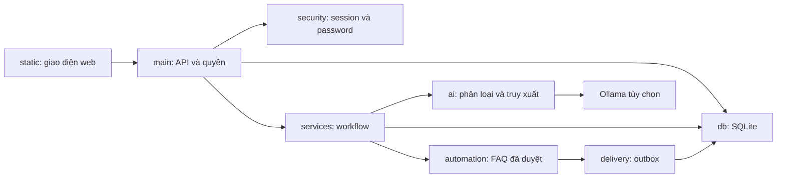
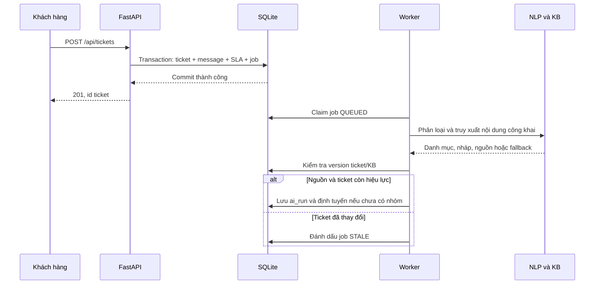
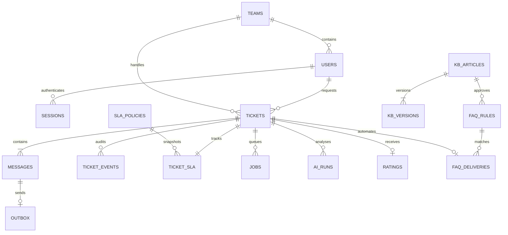

# Kiến trúc của bản triển khai cục bộ

Tài liệu này mô tả prototype phần mềm hiện có, không phải sản phẩm bàn giao phân tích tuần 1. Phạm vi học phần được chốt ở UC01–UC08 trong [kế hoạch tuần 1](../../Ke-hoach-tuan-1-Use-Case-Chu-de-07.md); các luồng bên dưới hiện thực một phần những UC đó. Prototype dùng tham khảo khi nhóm thiết kế, không thay cho sơ đồ và đặc tả do nhóm review.

## Quyết định công nghệ

- Backend: FastAPI/Pydantic, Python >=3.11. Phiên bản thực tế khóa trong `uv.lock`.
- Lưu trữ: SQLite, foreign keys, WAL, transaction `BEGIN IMMEDIATE` cho các cập nhật nguyên tử.
- Frontend: HTML/CSS/JavaScript không cần bước build, cùng origin với API.
- Bảo mật: opaque session cookie, token băm trong DB, PBKDF2 mật khẩu, kiểm tra Origin trên mutation từ trình duyệt.
- AI: Naive Bayes và TF-IDF chạy tại máy; Ollama là adapter tùy chọn qua HTTP.
- Runtime: một tiến trình uvicorn và một worker nền; không hỗ trợ nhiều tiến trình worker trong bản demo.

## Package diagram

## Sequence: tiếp nhận và phân tích

## Dữ liệu thực tế

Schema đầy đủ ở `app/db.py`; phiên bản 2 thêm outbox, FAQ và cấu hình lỗi email mô phỏng; phiên bản 3 thêm snapshot phiên bản KB bất biến trên mỗi trả lời FAQ. Nâng cấp v1/v2 giữ ticket, session và dữ liệu cũ. Câu FAQ xếp hàng từ schema v2 không có snapshot sẽ bị hủy an toàn khi nâng cấp. Khi đổi cấu trúc sau này cần thêm migration có số phiên bản.

## FAQ và gửi phản hồi

`faq_rules` lưu câu hỏi chuẩn hóa, mã bài, phiên bản được phê duyệt và người duyệt. Chỉ ticket mới, ưu tiên NORMAL/LOW, chưa có nhân viên trao đổi và chưa dùng FAQ mới đủ điều kiện. `faq_deliveries` có khóa duy nhất theo ticket và snapshot phiên bản nguồn; nội dung sinh bởi LLM không đi qua nhánh tự gửi.

Phản hồi Agent/FAQ tạo message PENDING và outbox QUEUED trong cùng transaction. Worker gọi adapter cổng web hoặc email mô phỏng; thành công mới ghi `first_response_at`. Lỗi giữ message FAILED cho nhân viên thử lại; retry dùng cùng message_id. Khách chỉ thấy message PUBLIC đã DELIVERED. FAQ được kiểm tra lại trước lần gửi/thử lại và chuyển CANCELLED nếu phê duyệt hoặc hội thoại không còn hợp lệ.

Các trạng thái outbox: QUEUED, DELIVERED, FAILED, CANCELLED. Cơ chế này bảo đảm không gửi trùng trong phạm vi adapter cục bộ; chưa có cam kết exactly-once cho SMTP/nhà cung cấp ngoài.

API bổ sung: GET/POST `/api/kb/articles/{id}/faq-rules`, PATCH `/api/faq-rules/{id}`, GET/POST `/api/channels/email/simulation` và POST `/api/messages/{id}/retry`. Các API duyệt FAQ/cấu hình lỗi yêu cầu Supervisor/Admin; retry kiểm tra quyền nhân viên trên ticket.

Bản cục bộ đơn giản hóa mỗi người dùng có một vai trò và một nhóm; chưa có bảng đa vai trò/đa nhóm. Nguồn AI là snapshot JSON của mã bài, phiên bản và điểm truy xuất; bài được kiểm tra lại trước khi hiển thị. Các khác biệt này cần được phản ánh nếu nhóm cập nhật ERD nộp chính thức.

## Giao diện

- Khách hàng: danh sách ticket riêng, tạo yêu cầu, hội thoại, xác nhận/mở lại, đánh giá và KB đã xuất bản.
- Agent: hàng đợi nhóm, nhận việc, tin nhắn công khai, ghi chú nội bộ, gợi ý AI và soạn KB nháp.
- Supervisor: tổng quan toàn tổ chức demo, phân công, xem SLA, xuất bản/thu hồi KB.
- Admin: các quyền Supervisor, tạo người dùng và tạo phiên bản SLA mới.

API chi tiết gồm schema request/response và lỗi validation được sinh từ các model tại `/openapi.json`. Những endpoint trả cấu trúc linh hoạt hiện chưa khai báo response model riêng; cần hoàn thiện hợp đồng phản hồi khi nhóm chốt D2.
